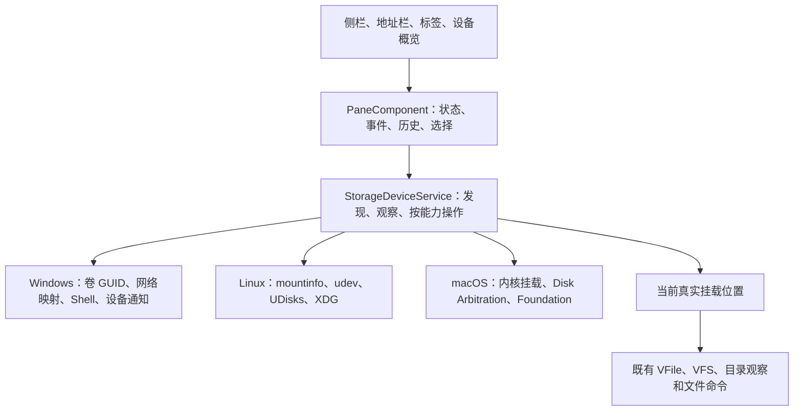

# 桌面系统位置与设备能力

本次实现把“此电脑”作为 Onyx 的应用位置接入现有面板，同时建立 Windows、Linux、macOS 的设备服务边界。它不等同于完整复刻 Explorer、Finder 或 Linux 桌面的全部原生功能。平台底座阶段已在 Windows 与 Linux 运行设备流程及应用交互验收；本轮磁盘概览界面改版仅在 Windows 实跑，macOS 原生调用仍需实机验证。

## 架构决定

### ADR-001：系统位置独立于文件路径

状态：采用。

概览使用稳定地址 `system://computer`，可以保存到标签、收藏和浏览历史。Windows 显示“此电脑”，其他桌面系统显示“电脑”；名称跟随应用语言。`shell:MyComputerFolder` 和对应标准 Shell CLSID 是此位置的输入别名。

`StorageDevice` 表达卷身份、当前挂载位置、状态、容量、只读属性、错误和操作能力。设备不是普通文件，不会因为列表中出现一个磁盘就获得重命名、删除或传输能力。真正打开的目录仍通过统一 `VFile`、仓储与文件命令服务处理。

相较于仅枚举盘符，这种模型可以保留改换挂载点后的选择，也能表达未挂载卷、网络挂载及同卷多个入口。代价是设备概览需要自己的派生状态和选择逻辑，不能直接套用普通文件条目。



`DesktopLocationPathService` 装饰既有路径服务：本地文件系统根目录的导航上级可以是概览，但物理父子关系、祖先判断和传输规则保持独立。概览不能成为文件传输源或目标。Linux/macOS 中普通挂载目录仍遵循其文件系统目录层级。

`SystemLocationVfsProvider` 把概览接入统一路由，只列举真实已挂载入口，声明独立 `SYSTEM` 协议及只读能力。未挂载设备通过设备模型表达，不构造虚假的可浏览文件。

### ADR-002：统一语义，按真实能力暴露操作

状态：采用。

共享层只定义 `StorageDeviceService`、`StorageDeviceAction` 和普通数据模型；原生句柄、JNA 对象和进程留在 JVM 平台实现。桌面目标均运行 JVM，因此本次通过接口注入与运行时平台选择隔离操作系统，不增加无实际用途的源码集。

菜单由设备 `actions` 派生；执行前按稳定身份重新发现并校验，不能用旧菜单操作已拔出的设备。未提供能力时不显示相应操作，而不是显示一个无法工作的按钮。新增原生功能应先明确公共语义和错误模型，再补实现与能力声明。

| 平台 | 发现与身份 | 已实现的原生能力 | 更新来源 |
| --- | --- | --- | --- |
| Windows | 原生卷 GUID、所有可见挂载点、逻辑盘、按 UNC 目标合并的网络映射 | Known Folders 标准目录、系统文件管理器打开、属性、光驱弹出 | 专用隐藏窗口的 `WM_DEVICECHANGE` |
| Linux | `/proc/self/mountinfo`、udev 文件系统 UUID／设备号、网络文件系统、Btrfs 子卷挂载 | XDG 标准目录；可用时通过 `udisksctl` 挂载／卸载，通过 `gio`／`xdg-open` 打开 | UDisks 通知；缺失时仍可读内核挂载表 |
| macOS | 内核挂载缓存、Disk Arbitration 卷 UUID、后台补充的 `diskutil` plist 卷清单 | Foundation 标准目录、挂载／卸载、原生允许时弹出、Finder 打开与信息窗口 | 独立 Core Foundation 循环中的 Disk Arbitration 回调 |

不采用“把所有系统入口转换成 `java.nio.Path`”的方案，因为 Shell 命名空间、设备与普通文件有不同的生命周期和权限。也不把所有平台功能集中到一个万能平台类，现有剪贴板、回收站、系统菜单等服务仍保留各自职责。

### ADR-003：轻量发现与慢元数据分离

状态：采用。

先发布设备清单，再异步补充容量等元数据。容量最多同时占用 4 个后台线程，单设备界面等待预算为 800ms，完成的元数据缓存约 30 秒。仍在执行的原生调用被复用，不因界面等待超时反复启动。等待超时不代表底层 I/O 已被中断，所有 4 个工作线程均被慢系统调用占用时，其他容量查询也需要等待；设备清单和已有导航仍可使用。

原生事件优先，另外每 5 秒校验完整清单，以覆盖丢失通知和缺少桌面服务的情况。最后一个订阅释放后停止观察资源。Windows 窗口、卷枚举句柄、macOS 会话和回调引用均由平台层释放。工具命令使用独立参数，不拼接 Shell；进程和输出读取都有超时及清理。

设备操作以设备身份互斥，双面板不能同时重复挂载或弹出，也不排队执行可能已过时的命令。组件记录在途任务，并同步清理后台标签的忙碌标记。异步打开仅在原标签与原访问仍活动时导航，切走后完成不会抢走新页面。

## 失败与数据边界

设备发现失败保留上一份列表；单设备元数据失败只标记该设备。标准目录读取失败、整体发现失败、用户操作失败分别存储，周期设备更新不能自动抹掉操作错误。界面提供显式刷新入口。

普通文件命令、快捷键和菜单在概览中禁用。文件拖放控制器同步读取子面板的最新状态，拒绝把概览或导航前遗留的目录区域作为目标，避免根聚合状态与旧布局尚未更新时触发错误传输。进入真实目录后恢复原有文件操作能力。

设备快照、容量、错误和忙碌状态不持久化到用户设置；已有设置和收藏存储位置不改变。测试使用构建目录内的隔离应用状态，截图和日志保留在 `composeApp/build/storage-acceptance/`，不进入源码。

## 交互与显示

设备概览复用现有侧栏入口、地址栏、标签、浏览历史、选择、菜单与视口逻辑，默认显示磁盘概览，并保留紧凑列表。两种模式均使用虚拟化容器；设备名称、容量和限制状态分别表达，窄面板也保留只读、忙碌、离线及错误提示。

此电脑的视图偏好独立保存在标签状态与会话快照中，普通目录的视图偏好分别保存，导航与历史恢复不会相互覆盖。卷标与盘符合并显示，例如 `Other (D:)`；缺少卷标时使用本地化设备类型。根面包屑可显示为“此电脑 › Other (D:)”，真实导航和地址编辑仍使用 `D:\`。

用户按住或滚动时延迟设备重排及上方目录入口插入，容量补全不重置选择或视口。根目录直接向上进入概览时定位原设备；用户已主动选择其他条目后，迟到结果不再抢占选择。

标准目录从系统目录 API 或 XDG 配置解析，不能用固定用户路径猜测，也不把用户所有固定书签重复进概览。XDG 标准目录配置不存在时，主目录仍可使用。系统目录名称、操作和状态支持英文、简体中文及日语；用户自定义卷标与书签名称保留系统原文。

外观继承 Jewel、`OnyxAppearance` 和 `OnyxPalette`。本次没有替换应用的视觉系统。Linux 中日文显示依赖运行环境提供相应字体；本地 WSL 验收在生成目录配置了隔离的 Noto CJK 字体，未修改系统字体配置或引入产品字体资产。

### 设备概览显示约定

- 两种模式的顶部均为横排换行的系统文件夹入口，下方依次显示本地、网络、可移动、光驱、其他设备的非空分组。分组标题带可见数量与细分隔线；文件夹按 104dp 基准宽度计算换行，磁盘概览网格按 `ComputerAppearance.deviceMinWidth`（默认 255dp）自适应，不使用普通文件画廊的项目尺寸。
- 设备名称使用列表字号（默认 12sp）与中等字重，容量和状态使用表头字号（默认 11sp）；分组标题使用表头字号与中等字重。磁盘概览条目最小高度为三倍列表行高，紧凑列表为两倍，列表行高默认 22dp。公共水平内边距为 8dp，内容间距为 6dp；概览图标为 24dp，列表图标为 16dp。分组间距 12dp、磁盘间距 8dp、容量条高度 4dp，集中取自 `OnyxAppearance` 与 `ComputerAppearance` 并响应应用缩放。
- 紧凑列表的名称、可用空间、总容量和使用情况与表头共用列宽；可用空间列保留，面板达到 420dp 时显示占用条列，达到 500dp 时显示总容量列。设备名称与非盘符挂载位置单行省略，限制提示可以换行，错误单独显示；容量文案可换行。两种模式均保留垂直滚动条，菜单打开时暂停用户滚动。
- 忙碌、只读、不可用、未挂载及空间不足提示独立于容量显示，不再用容量摘要替代。仅在已挂载且容量有效时绘制占用条；查询中、容量未知、未挂载和不可用均使用对应文案，不生成零值进度。已知剩余空间低于 10% 时显示空间不足提示并使用 `OnyxPalette.error` 绘制占用条；错误文字，以及不可用或空间不足设备的限制文字使用 `errorForeground`，其余限制文字使用弱化前景色。
- 整个条目承载统一选择与打开交互：单击同时激活面板并选择，Ctrl／Command 增选、Shift 范围选择，双击激活面板并打开，右键激活面板并请求菜单。活动与非活动选择背景读取全局外观覆盖或对应调色板值，未选中条目悬停使用统一行悬停色；名称响应全局文件名颜色，尺寸与字号随应用缩放。

## 已完成的验证与限制

### 平台底座阶段

此前的真实宿主流程覆盖发现、异步容量、稳定身份、统一只读 Provider、根导航与物理路径语义。组件流程使用真实 NIO 目录和生产服务，仅在平台边界控制挂载与延迟，覆盖挂载点更新、跨面板重复操作、切换标签后的迟到结果、操作失败保留和慢盘查询合并。Windows 通知测试向本进程专用窗口发消息，并验证订阅取消后窗口销毁，不操作用户磁盘。

平台底座曾在 Windows 和 Linux/WSL 实跑。Linux/WSL 的 10 项设备流程与解析场景中，9 项通过、1 项 Windows 专属通知测试按平台跳过；Linux/WSLg 的 6 项生产入口 UI 测试通过。该阶段界面测试覆盖旧版设备列表和画廊，不能视为本轮磁盘概览新界面的 Linux 验收。

macOS 仍只有此前的编译和结构化协议检查，Disk Arbitration 回调、Finder 动作、APFS 卷清单与实际挂载／弹出需实机验证。Linux 底座验收环境没有 `udisksctl`，原生挂载／卸载与热插拔需在带 UDisks 的桌面系统验证；Windows 光驱动作也未进行真实介质验收。

### 本轮磁盘概览界面

本轮仅在 Windows 实跑。IDEA MCP 的最终 `build_project` 返回 `isSuccess=true`，仅有既有 UI 测试 API 的弃用警告；本次 IDEA MCP 未暴露运行测试工具，因此测试使用 Gradle。版本为 Compose Multiplatform 1.12.1、Compose Hot Reload 1.2.0；Hot Reload MCP 已连接，但 `list_windows=[]`、`buildContinuous=false`，未完成 MCP 窗口交互验收，界面验证改用官方 Compose 测试，从生产 DI 与 App 根入口运行并生成稳定截图。

最终五模块回归共 245 项通过，失败、错误和跳过均为 0：`composeApp` 213 项、`shared` 11 项、`vfs-api` 6 项、`vfs-local` 15 项，`core` 无测试源；五模块 Detekt 通过。Windows 覆盖真实磁盘、侧栏、双击和根导航、卷名面包屑、此电脑与普通目录的独立视图偏好及历史恢复、设备更新与选择、双面板、中英日、窄窗口和 100%～150% 缩放。拖放回归确认概览与旧目录区域均不能成为目标，源文件保留且无传输任务新增。

本轮截图保留在 `composeApp/build/storage-acceptance/redesign-review/`。只读、离线、容量未知等状态使用控制平台快照，不等同于真实介质验收；浅色错误文字默认／选中态对比度和容量未知截图完整性两项经独立复核为 `resolved`，本次修复复核结论为 `ship`，仅覆盖上述两项。暗色、悬停和焦点未做本轮截图，Linux/macOS 未实机复测本轮新 UI。测试与截图均使用隔离构建目录，未进行安装、推送或发布。

本轮最终回归命令：

```powershell
.\gradlew.bat :composeApp:jvmTest :core:jvmTest :shared:jvmTest :vfs-api:jvmTest :vfs-local:jvmTest --no-build-cache '-Pkotlin.incremental=false' --console=plain -q
.\gradlew.bat :composeApp:detekt :core:detekt :shared:detekt :vfs-api:detekt :vfs-local:detekt --console=plain -q
```

## 后续原生能力的接入规则

Windows USB 安全移除、MTP、任意 Shell 命名空间、WSL 专用入口，以及 macOS Quick Look、Finder 标签等，不属于本次已实现能力。接入时沿用上述公共语义、平台适配、按能力声明与执行前校验边界；涉及真实文件内容的能力必须补齐 VFS，不能直接从 Composable 调用系统 API。需要长期配置的能力进入既有设置模型，原生句柄不得持久化。

## 系统接口参考

- [Microsoft：卷管理 API](https://learn.microsoft.com/en-us/windows/win32/fileio/volume-management-functions)
- [Microsoft：Known Folder 路径与内存释放约定](https://learn.microsoft.com/en-us/windows/win32/api/shlobj_core/nf-shlobj_core-shgetknownfolderpath)
- [Linux 内核：proc 文件系统与 mountinfo](https://www.kernel.org/doc/html/latest/filesystems/proc.html)
- [Apple：Disk Arbitration](https://developer.apple.com/library/archive/documentation/DriversKernelHardware/Conceptual/DiskArbitrationProgGuide/Introduction/Introduction.html)
